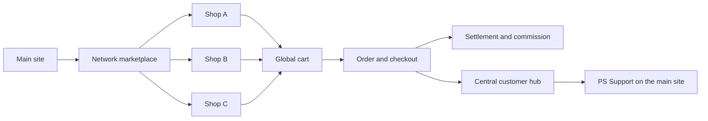

# PS MarketPress

[Deutsch](README.md) | **English**

[](readme.txt)


[](https://www.gnu.org/licenses/gpl-2.0.html)


**The complete e-commerce and marketplace solution for ClassicPress and Multisite.**

PS MarketPress powers both standalone online stores and complete shop networks. Products, variations, orders, payments, shipping, digital downloads, and customer workflows are included out of the box. In a Multisite environment, it becomes a centralized marketplace platform with a global cart, shop profiles, a customer hub, commission settlement, and granular permission management.

No mandatory extensions, no feature restrictions, and no recurring license fees.

## B2B invoicing without suite bloat

For ordinary business-to-business commerce, PS MarketPress includes two lean, optional add-ons rather than an oversized enterprise suite:

- **B2B billing details:** Business customers can provide a company name, VAT ID, and tax number at checkout or in their user profile. The details are saved with the order and included in the existing PDF invoice.
- **B2B invoice XML:** Complements the PDF invoice with a structured XML file containing seller and buyer information, invoice number, line items, shipping, discounts, and net, tax, and gross totals. Admin download, customer download, and email attachment are configurable per store.
- **Practical instead of government workflow:** Optional EU reverse charge for qualifying B2B orders; no XRechnung or ZUGFeRD claim, Java runtime, external service, or new large dependency tree.

## Why PS MarketPress?

- **One plugin for stores and marketplaces:** from a single store to a network with many independent sellers.
- **Multisite at its core:** global product lists, centralized navigation, shop profiles, and network-wide order flows.
- **Complete commerce workflow:** products, variations, inventory, taxes, coupons, checkout, shipping, and order management.
- **Digital products:** protected downloads, download limits, free downloads, and multiple files per product.
- **Customer-focused workflows:** order lookup, payment retries, reviews, and digital withdrawal management.
- **Open and extensible:** shortcodes, widgets, hooks, built-in add-ons, and integrations with the PSOURCE ecosystem.

## Network and marketplace

PS MarketPress does not treat Multisite as an afterthought. Network features are integrated directly into product presentation, cart, checkout, orders, and settlement.

### Central marketplace

- Display products from all enabled stores on the main site
- Network-wide categories, tags, and filters
- Dynamic product and store links in the correct blog context
- Choose between a direct product view and a central shop profile page
- Global cart across multiple stores
- Configurable floating cart on the main site

### Shop profiles

- Dedicated profile pages for seller stores
- Branding, description, links, and social-media details
- Tabs for products, coupons, and reviews
- Category pre-filtering and AJAX-powered navigation
- Optional shop ratings in the network

### Central customer hub

- Orders from all participating stores in one overview
- Total revenue, open deliveries, and pending reviews
- Global cart and product recommendations
- Withdrawal status for each order
- Direct access to central main-site support
- Snapshot-based data preparation for fast loading times

### Commissions and payouts

- Configurable marketplace commission
- Adjustable calculation basis and tax portion
- Holding periods and automatic release
- Central settlement ledger
- Moderation of releases, holds, and payouts
- Dedicated settlement view for shop operators
- Separate `manage_settlement_approvals` permission for the release workflow



## Store features

### Products and sales

- Physical and digital products
- Product variations with individual prices, stock, images, and descriptions
- Sale prices, product limits, and inventory management
- Product images, galleries, and video URLs
- Related, popular, and featured products
- External product and purchase links
- Checkout for registered users and guests

### Orders and customers

- Central order management with status and action filters
- Order lookup for customers and guests
- Payment retries for pending orders
- Email notifications with customizable templates
- Product reviews with star ratings and a helpful-vote feature
- PDF invoices and delivery notes
- Optional B2B billing details for business customers at checkout and in user profiles
- Structured B2B invoice XML export in addition to the PDF invoice
- Export and statistics features

### Digital withdrawals

- Two-step digital withdrawal declaration
- Immediate confirmation by email
- Withdrawal eligibility and exclusion reason per product
- Immutable snapshot of ordered items
- Customer status from submission through refund or completion
- Admin processing with internal status and note
- Network-wide overview in the central customer hub

## PSOURCE integrations

### PS Support

The optional integration connects orders directly to the central support system:

- Order-related support requests from the customer area and order history
- Central ticket storage on the configured main site
- Preserves the responsible store as ticket and order context
- Central FAQ page and product-specific FAQ links
- Automatic provisioning of required support pages in Multisite
- Permission checks in the actual support context

### PS Bloghosting / Pro Sites

For commercial shop networks, features can be enabled by plan level:

- MarketPress access per Bloghosting level
- Available payment gateways by plan
- Available shop themes by plan
- Automatic consideration of an active subshop plan

### PS Update Manager

The [PSOURCE Update Manager](https://github.com/Power-Source/ps-update-manager/releases/latest) centralizes installation and updates of PSOURCE projects. It keeps PS MarketPress and complementary plugins up to date from one place.

### Included add-ons

- Coupons and discount codes
- PDF invoices and delivery notes
- B2B billing details with configurable extra fields and optional EU reverse charge
- B2B invoice XML with admin and optional customer downloads plus email attachment
- Multiple download files per product
- Product comments and reviews
- Shop statistics with Chart.js
- Network shop profiles
- PS Bloghosting integration

## Payment methods

PS MarketPress registers the following payment gateways:

- Stripe
- PayPal Express
- PayPal Marketplace / Commerce Platform
- Mollie
- Authorize.Net AIM
- eWay Shared Payments
- eWay Rapid 3.1 (Beta)
- Simplify Commerce by Mastercard
- Manual payment
- Free orders

Availability can be centrally restricted in the network and additionally tied to plan levels through PS Bloghosting.

## Shipping

- Flat rate
- Local pickup
- Shipping by cart value
- Shipping by weight
- FedEx (Beta)
- UPS (Beta)
- USPS

Shipping zones, destination countries, taxes, and product-specific shipping data can be managed in the store settings.

## Installation

### Requirements

- ClassicPress 2.7.1
- PHP 8.0 or later
- For marketplace features: an enabled ClassicPress Multisite network

### Single store

1. Download the current version from [Releases](https://github.com/Power-Source/marketpress/releases/latest).
2. Install the plugin in `wp-content/plugins/marketpress`.
3. Activate **PS MarketPress** in the Plugins screen.
4. Open the setup wizard and configure store pages, currency, taxes, shipping, and payments.
5. Create products and test checkout.

### Multisite and marketplace

1. Activate PS MarketPress network-wide.
2. Enable the global cart and the required marketplace features in the network settings.
3. Assign network pages for the marketplace, customer hub, and shop profiles.
4. Configure gateways, themes, commissions, and permissions centrally.
5. Optionally connect PS Support and PS Bloghosting.

## Important shortcodes

### Store

| Shortcode | Purpose |
| --- | --- |
| `[mp_list_products]` | Product list with filters and sorting |
| `[mp_product]` | Single product |
| `[mp_buy_button]` | Purchase button |
| `[mp_cart]` | Cart |
| `[mp_checkout]` | Checkout |
| `[mp_order_status]` | Order lookup and customer area |
| `[mp_product_rating]` | Product rating |
| `[mp_store_navigation]` | Store navigation |

### Network

| Shortcode | Purpose |
| --- | --- |
| `[mp_list_global_products]` | Products from the entire network |
| `[mp_global_categories_list]` | Network-wide categories |
| `[mp_global_tag_cloud]` | Network-wide tags |
| `[mp_network_customer_hub]` | Central customer hub |
| `[mp_network_shop_profile]` | Central shop profile page |
| `[mp_network_shop_performance]` | Shop performance overview |
| `[mp_network_settlement_dashboard]` | Store settlement overview |

Many shortcodes support additional attributes. Full options are described in the [documentation](https://psource.eimen.net/wiki/ps-marketpress-dokumentation/).

## Development and extension

PS MarketPress provides many actions and filters for products, cart, checkout, orders, gateways, shipping, Multisite routing, and add-ons. Custom integrations can be registered without modifying the plugin core.

Frontend assets are built with Grunt:

```bash
npm install
npm run build
```

PHP dependencies are defined through Composer:

```bash
composer install
```

## Help and project links

- [Documentation](https://psource.eimen.net/wiki/ps-marketpress-dokumentation/)
- [Releases](https://github.com/Power-Source/marketpress/releases/latest)
- [Source code and issues](https://github.com/Power-Source/marketpress)
- [PSOURCE](https://psource.eimen.net/)
- [PS Update Manager](https://github.com/Power-Source/ps-update-manager/releases/latest)

## License

PS MarketPress is free software, released under the **GNU General Public License v3.0 or later**.
