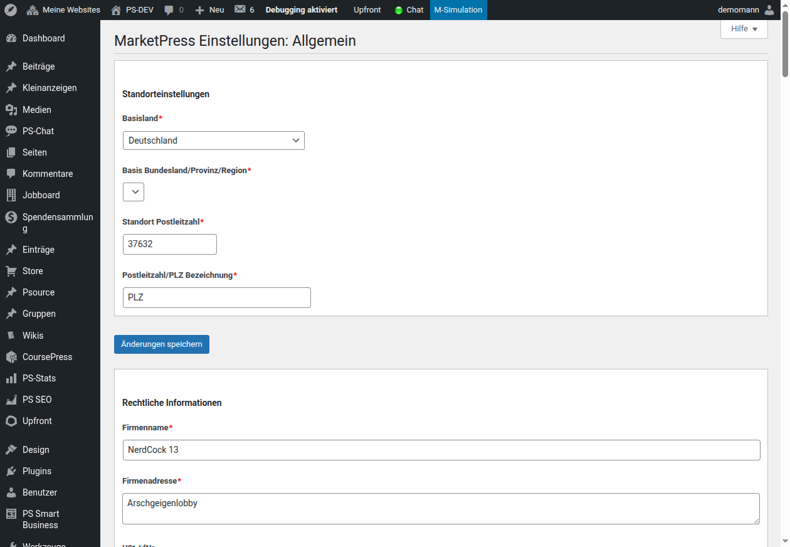
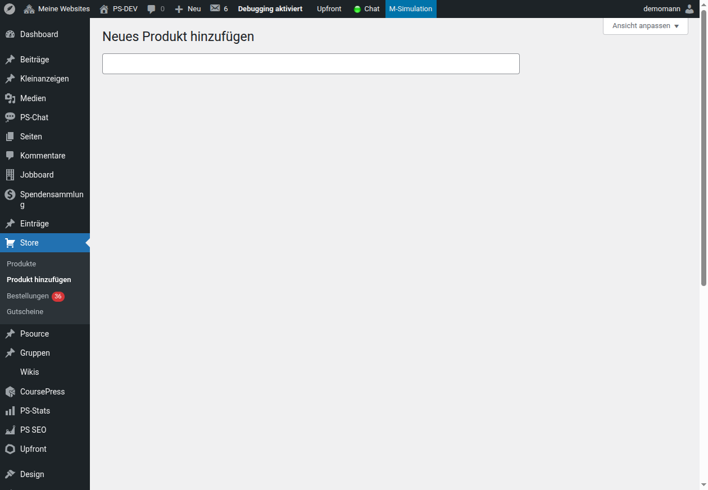
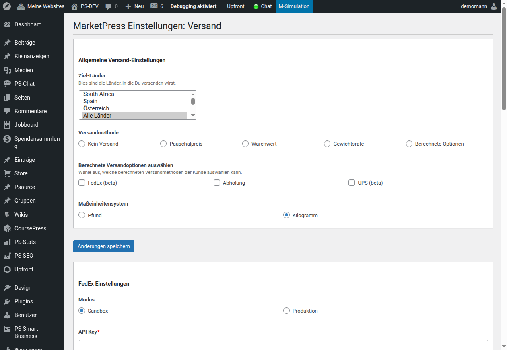
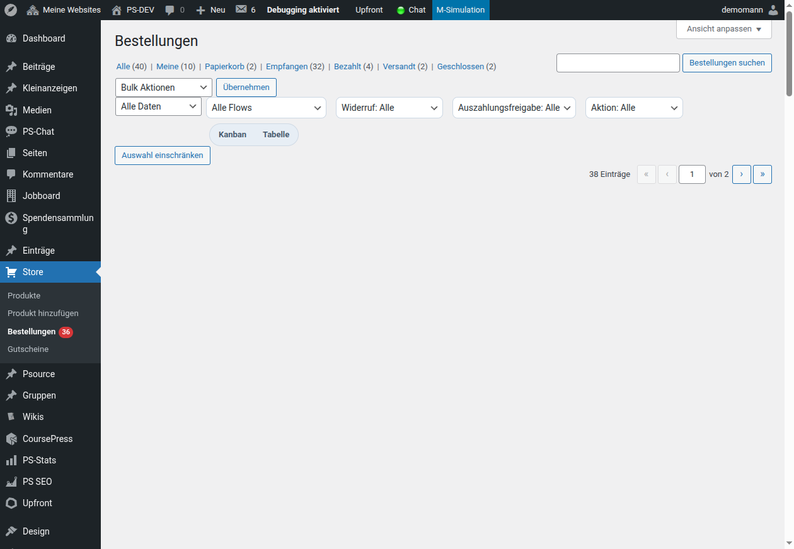

# PS MarketPress – Handbuch

PS MarketPress ist eine E-Commerce-Lösung für einzelne Shops und
ClassicPress-Multisite-Marktplätze. Dieses Handbuch beschreibt die
Grundkonfiguration, Produkte, Bestellungen, Versand, Zahlungen und
Netzwerkfunktionen.

## Voraussetzungen und Installation

- ClassicPress 2.7.1 oder neuer
- PHP 8.0 oder neuer
- Für Marketplace-Funktionen: ein aktiviertes ClassicPress-Multisite-Netzwerk

Installiere den Ordner `marketpress` unter `wp-content/plugins/` und aktiviere
**PS MarketPress** unter **Plugins**. Öffne anschließend
**MarketPress → Schnelle Einrichtung**, um die benötigten Shopseiten,
Währung, Steuern, Versand und Zahlungen festzulegen.

> **Vor dem Livegang:** Schließe erst die Konfiguration ab und teste Checkout,
> E-Mail-Versand, Zahlung und Versandkosten mit einer Testbestellung.

## Verwaltung im Backend

Die tägliche Arbeit findet in zwei Menübereichen statt:

- **Store:** Produkte, neue Produkte, Bestellungen und Gutscheine
- **MarketPress:** Allgemein, Präsentation, Benachrichtigungen, Versand,
  Zahlungen, Produkteigenschaften, Berechtigungen und Erweiterungen

## Shop grundlegend konfigurieren

### Allgemein

Unter **MarketPress → Allgemein** legst Du die Grunddaten des Shops fest,
insbesondere Währung, Preisformat, Steuern, die Shopseiten und die URL-Struktur.

Lege für Produktübersicht, Warenkorb, Checkout und Bestellstatus eigene
Seiten an beziehungsweise weise vorhandene Seiten zu. Ändere URLs und
Slug-Einstellungen nicht unbedacht nach der Veröffentlichung, weil bestehende
Links und Suchmaschinen-Einträge betroffen sein können.

### Präsentation und Benachrichtigungen

Unter **Präsentation** passt Du Produktdarstellung, Bilder, Listen, Warenkorb
und Shop-Layout an das Theme an. Unter **Benachrichtigungen** steuerst Du die
E-Mails für Kunden und Shopbetreiber. Prüfe Absender, Empfänger, Betreff und
Inhalt mit einer echten Testbestellung.

### Berechtigungen und Erweiterungen

Unter **Berechtigungen** weist Du Shop-Aufgaben den passenden Rollen zu.
Beschränke insbesondere Rechte für Bestellungen, Rückerstattungen, Zahlungen,
Gutscheine und Abrechnungen auf die Personen, die sie wirklich benötigen.

Unter **Erweiterungen** aktivierst Du optionale Funktionen wie Gutscheine,
PDF-Rechnungen und Lieferscheine, B2B-Rechnungsdaten, B2B-Rechnungs-XML,
Mehrfach-Downloads, Bewertungen, Statistiken und Shopprofile.

## Produkte anlegen

Öffne **Store → Produkt hinzufügen**. Ein Produkt ist ein eigener
Beitragstyp mit zusätzlichen Produktfeldern.

1. Vergib einen aussagekräftigen Produkttitel und ergänze die Beschreibung.
2. Wähle Produktart, Preis und gegebenenfalls Sonderpreis.
3. Lege Lagerbestand, SKU und Produktlimit fest, wenn diese Funktionen
   benötigt werden.
4. Ergänze Produktbilder, Galerie, Kategorien, Schlagwörter und Attribute.
5. Konfiguriere Versanddaten für physische Produkte.
6. Hinterlege für digitale Produkte die geschützten Download-Dateien sowie
   Downloadlimits.
7. Lege Varianten an, wenn Optionen wie Größe oder Farbe eigene Preise,
   Bestände oder Bilder benötigen.
8. Veröffentliche erst nach einer Vorschau und einem Test des Kaufablaufs.

### Physische, digitale und externe Produkte

- **Physische Produkte** benötigen in der Regel Gewicht, Versandklasse oder
  eigene Versanddaten.
- **Digitale Produkte** können mehrere Dateien, geschützte URLs und
  Downloadlimits verwenden. Prüfe nach dem Kauf, ob der Kunde nur auf die
  vorgesehenen Dateien zugreifen kann.
- **Externe Produkte** leiten über einen externen Kaufen-Link zu einem
  anderen Angebot weiter.

### Varianten und Eigenschaften

Lege wiederkehrende Eigenschaften unter
**MarketPress → Produkteigenschaften** an. Weise sie anschließend den
passenden Produkten zu. Varianten sind sinnvoll, wenn Auswahloptionen eigene
Preise, Bestände, Bilder oder Beschreibungen erhalten sollen.

## Versand und Steuern

Konfiguriere Versand unter **MarketPress → Versand**.

MarketPress unterstützt unter anderem Pauschalpreis, Abholung, Versand nach
Warenwert und Gewicht sowie optionale Schnittstellen für FedEx, UPS und USPS.
Lege Versandzonen, Zielländer und Versandmethoden so an, dass jede mögliche
Lieferadresse genau die vorgesehenen Optionen sieht.

Prüfe für jedes Produkt:

- ob es versandpflichtig ist,
- ob Gewicht oder Versandklasse erforderlich sind,
- ob kostenlose Lieferung oder Abholung zulässig ist,
- ob Steuern auf Produkt und Versand korrekt berechnet werden.

Teste mindestens eine Adresse je Versandzone sowie Warenkörbe mit und ohne
versandpflichtige Produkte.

## Zahlungen und Checkout

Unter **MarketPress → Zahlungen** aktivierst und konfigurierst Du die
gewünschten Gateways. Je nach Installation stehen unter anderem Stripe,
PayPal Express, PayPal Marketplace / Commerce Platform, Mollie,
Authorize.Net, eWay, Simplify Commerce, manuelle Zahlung und kostenlose
Bestellungen zur Verfügung.

Aktiviere nur Zahlungsarten, deren Zugangsdaten, Webhooks und
Produktiv-/Testmodus vollständig eingerichtet sind. Nutze für die
Erstkonfiguration die Testumgebungen der Zahlungsanbieter und dokumentiere,
wer Zugang zu den Anbieter-Konten besitzt.

Der Checkout wird über die im Bereich **Allgemein** zugewiesene
Checkout-Seite eingebunden. Für Gastbestellungen müssen Datenschutz,
Rechnungsinformationen und Bestellbestätigung besonders sorgfältig geprüft
werden.

### B2B-Rechnungen

Die optionalen Add-ons **B2B-Rechnungsdaten** und **B2B-Rechnungs-XML**
erfassen Firma, USt-IdNr. und Steuernummer. Die Angaben werden mit der
Bestellung gespeichert und können in PDF-Rechnungen und XML-Dateien
ausgegeben werden. Aktiviere EU-Reverse-Charge nur, wenn der steuerliche
Prozess dafür fachlich geprüft ist.

## Bestellungen, Kunden und Rückgaben

Unter **Store → Bestellungen** verwaltest Du Bestellungen, Zahlungs- und
Lieferstatus sowie Kundeninformationen.

Nutze Filter und Suche, um offene Zahlungen, ausstehende Lieferungen und
erforderliche Aktionen zu finden. Ändere Bestellstatus nur, wenn der
tatsächliche Zahlungs- und Versandvorgang diesen Status rechtfertigt.

MarketPress bietet außerdem Bestellsuche für Kunden und Gäste, erneute
Zahlungsversuche für offene Bestellungen, PDF-Rechnungen und Lieferscheine.
Bei digitalen Widerrufen dokumentiert ein unveränderlicher Snapshot die
bestellten Positionen. Bearbeite Widerrufe mit internem Status und Notiz;
informiere Kunden über den jeweils nächsten Schritt.

## Gutscheine, Bewertungen und Add-ons

Unter **Store → Gutscheine** verwaltest Du Rabattcodes. Teste ihre
Gültigkeitszeiträume, Mindestbestellwerte, Produktbeschränkungen und
Kombinierbarkeit vor der Veröffentlichung.

Bewertungen, PDF-Rechnungen, Statistiken, Mehrfach-Downloads und
Shopprofile sind optionale Erweiterungen. Aktiviere jede Erweiterung nur,
wenn ihre Einrichtungsseite vollständig konfiguriert ist und der
Checkout- beziehungsweise Kundenablauf getestet wurde.

## Seiten, Shortcodes und Widgets

Der Einrichtungsassistent erstellt oder verknüpft die zentralen Shopseiten.
Für individuelle Inhalte stehen unter anderem diese Shortcodes bereit:

| Shortcode | Zweck |
| --- | --- |
| `[mp_list_products]` | Produktliste mit Filtern und Sortierung |
| `[mp_product]` | Einzelnes Produkt |
| `[mp_buy_button]` | Kaufen-Schaltfläche |
| `[mp_cart]` | Warenkorb |
| `[mp_checkout]` | Checkout |
| `[mp_order_status]` | Bestellsuche und Kundenbereich |
| `[mp_product_rating]` | Produktbewertung |
| `[mp_store_navigation]` | Shopnavigation |

Füge Checkout, Warenkorb und Bestellstatus nicht mehrfach auf derselben Seite
ein. Teste Shortcodes in einer Vorschau und mit einem vollständigen Kaufablauf.

## Single-Site

Bei einem einzelnen Shop werden Produkte, Bestellungen, Einstellungen und
Add-ons lokal auf dieser Website verwaltet. Der Warenkorb, die Währung,
Zahlungsarten und Versandregeln gelten für diesen Shop.

Die empfohlene Reihenfolge ist:

1. Shopseiten und Grunddaten einrichten.
2. Steuern, Versand und Zahlungen konfigurieren.
3. Produkte und Varianten anlegen.
4. E-Mails und Rechnungen prüfen.
5. Testbestellung, Stornierung und Download testen.
6. Erst danach den Shop veröffentlichen.

## Multisite und Marketplace

Für einen Marketplace wird MarketPress netzwerkweit aktiviert. In der
Netzwerkverwaltung konfigurierst Du die zentralen Marketplace-Funktionen,
beispielsweise globalen Warenkorb, Netzwerk-Währung, Produktdarstellung,
Gateways, Shopprofile, Kundenhub, Provisionen und Berechtigungen.

Auf Unterwebsites verwalten Shopbetreiber ihre Produkte und lokalen
Shop-Einstellungen nur im vorgesehenen Rahmen. Entscheide vor dem Start:

- ob Produkte zentral auf der Hauptseite gelistet werden,
- ob ein globaler Warenkorb Produkte mehrerer Shops enthalten darf,
- welche Gateways netzwerkweit und welche lokal verfügbar sind,
- ob Shopprofile und Shopbewertungen angezeigt werden,
- wie Provision, Haltefrist, Freigabe und Auszahlung ablaufen,
- wer die Berechtigung `manage_settlement_approvals` erhält.

Für Netzwerkseiten stehen zusätzlich diese Shortcodes bereit:

| Shortcode | Zweck |
| --- | --- |
| `[mp_list_global_products]` | Produkte aus dem gesamten Netzwerk |
| `[mp_global_categories_list]` | Netzwerkweite Kategorien |
| `[mp_global_tag_cloud]` | Netzwerkweite Schlagwörter |
| `[mp_network_customer_hub]` | Zentraler Kundenhub |
| `[mp_network_shop_profile]` | Shop-Profilseite |
| `[mp_network_shop_performance]` | Performance-Übersicht für Shops |
| `[mp_network_settlement_dashboard]` | Abrechnungsübersicht eines Shops |

> **Wichtig:** Aktiviere globalen Warenkorb, zentrale Gateways und
> Settlement erst nach einem Ende-zu-Ende-Test mit mindestens zwei Subshops.
> Dabei müssen Steuern, Versand, Zahlungsanbieter, Provisionen, E-Mails und
> Bestellansichten im richtigen Shop- und Netzwerk-Kontext geprüft werden.

## Livegang-Checkliste

- Alle Shopseiten sind zugewiesen und im Menü erreichbar.
- Währung, Preisformat, Steuer und Versandzonen sind geprüft.
- Jede aktivierte Zahlungsart wurde im vorgesehenen Testmodus getestet.
- Bestell-E-Mails, PDF-Rechnungen und B2B-Ausgaben sind korrekt.
- Lagerbestand, Varianten, Gutscheine und Downloads verhalten sich wie
  vorgesehen.
- Rollen und Berechtigungen sind auf das notwendige Minimum beschränkt.
- Datenschutz, Widerruf, Impressum und Shop-Richtlinien sind in den
  erforderlichen Shopseiten verlinkt.
- In Multisite sind globaler Warenkorb, Gateways, Shopprofile und Settlement
  mit mehreren Shops getestet.
